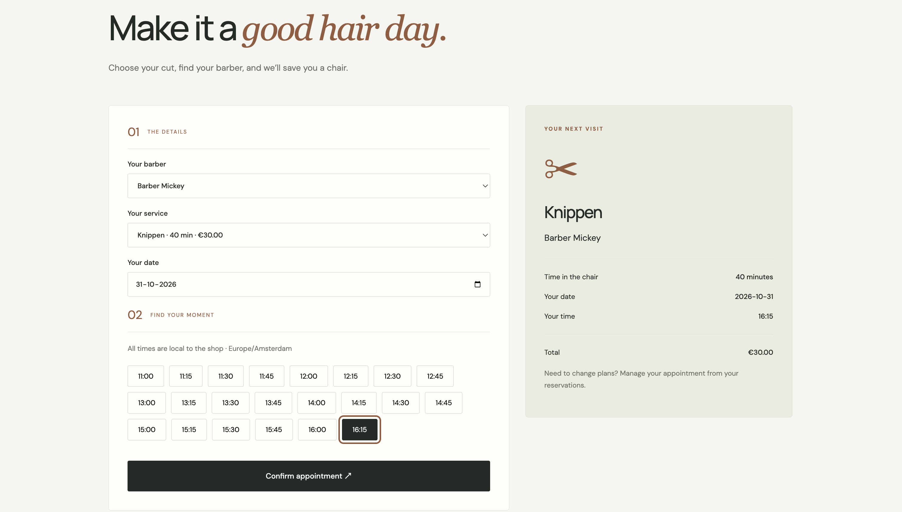
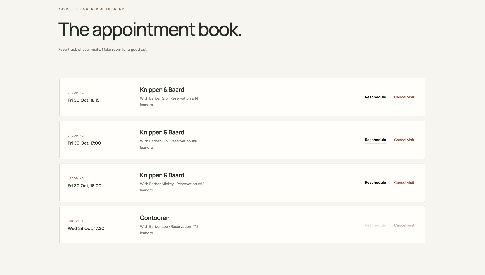
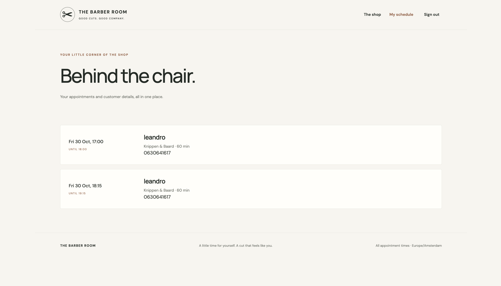
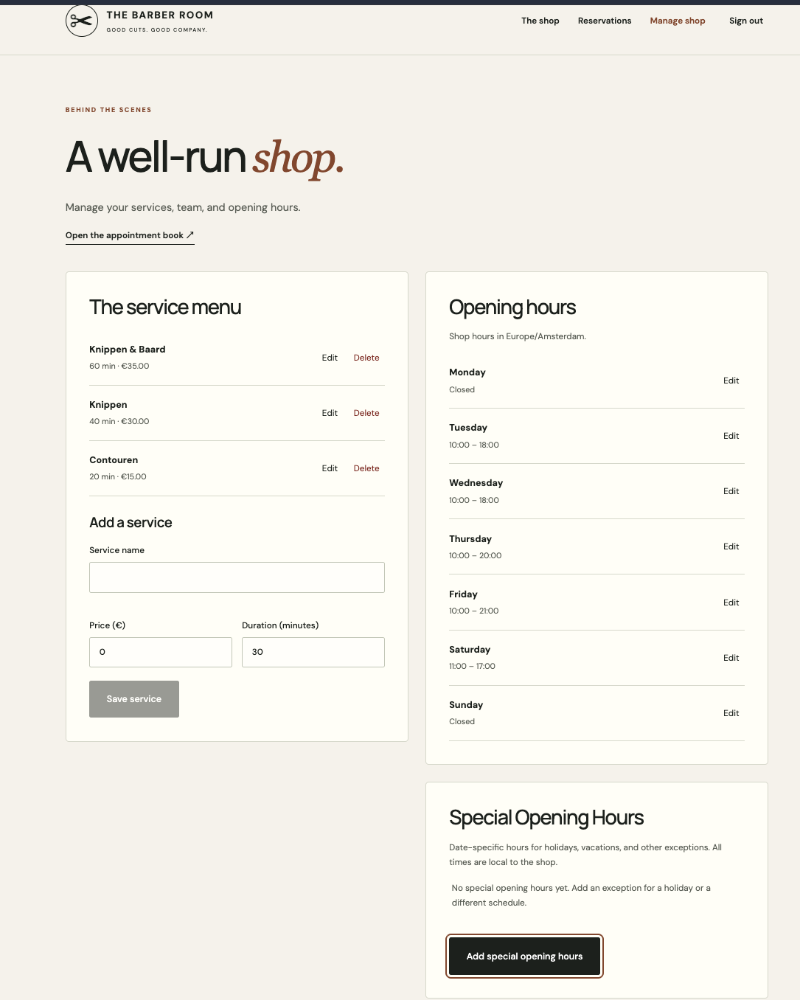
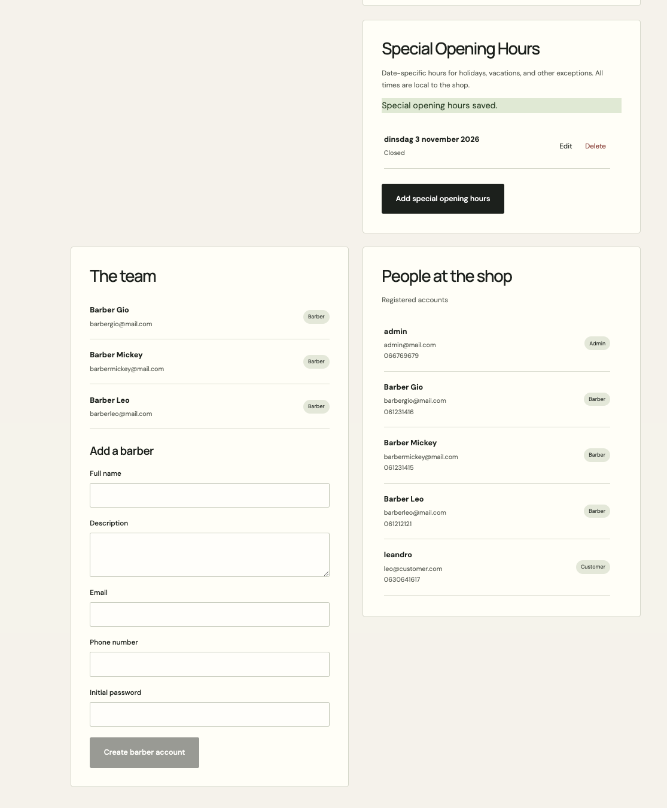

# BarberBookingSystem

A full-stack barbershop appointment booking application built with **ASP.NET Core (.NET 8), C#, Angular 21, and PostgreSQL**.

The application allows customers to browse haircut services, check appointment availability, book appointments, and manage their reservations through a responsive web interface.

Barbers can view their appointment schedules, while administrators can manage barber accounts, services, opening hours, and reservations.

The project focuses on RESTful API development, authentication, role-based authorization, automated testing, and reliable reservation management.

> **Project Status: Work in Progress**
>
> The core backend and Angular frontend are implemented. Additional validation, security improvements, and deployment are planned.

## Screenshots

### Appointment Booking


### Customer Dashboard


### Barber Dashboard


### Admin Dashboard

**Services & Opening Hours**



**Team & Customer Management**



## Tech Stack

### Backend
- **C# / .NET 8**
- **ASP.NET Core Web API**
- **Entity Framework Core**
- **PostgreSQL**
- **JWT Authentication**
- **BCrypt** – Password hashing
- **Swagger / OpenAPI**

### Frontend
- **Angular 21**
- **TypeScript**
- **HTML / CSS**
- **Angular Reactive Forms**
- **Angular Signals**
- **RxJS**

### Testing
- **xUnit** – Backend unit and integration tests
- **SQLite In-Memory** – Backend integration testing
- **Angular frontend tests** – Authentication, booking, and reservation management

## Features

### Authentication & Authorization
- User registration and login
- JWT-based authentication
- Secure password hashing using BCrypt
- Role-based authorization for Admin, Barber, and Customer
- Protected API endpoints and frontend routes

### Customer Features
- Browse available barbers and haircut services
- View available appointment slots for a selected date
- Book appointments
- View upcoming and previous reservations
- Reschedule existing appointments
- Cancel appointments

### Barber Features
- View assigned appointment schedules
- Access relevant customer and appointment details

### Admin Features

- View all reservations and registered customers
- Create barber accounts
- Manage haircut services, prices, and durations
- Manage regular weekly opening hours
- Configure special opening hours for holidays, temporary closures, and date-specific schedule changes
- Receive warnings when changing opening hours on dates with existing reservations

## Architecture

The application follows a client-server architecture. The **Angular frontend** handles user interactions and communicates with the **ASP.NET Core REST API**, which manages authentication, authorization, business logic, and database operations through Entity Framework Core.

### Appointment Availability

One of the core features is the dynamic calculation of available appointment slots.

Availability is determined by:

- Regular weekly opening hours
- Special opening hours for specific dates, including holidays and closures
- Selected haircut duration
- Existing reservations
- Selected barber and appointment date
- 15-minute booking intervals

Special opening hours override the regular weekly schedule, allowing administrators to close the barbershop or configure different opening times for individual dates.

The backend prevents overlapping reservations and validates appointments against both regular and special opening hours. Existing reservations remain unchanged when special opening hours are modified.

When rescheduling, the system excludes the customer's existing reservation from availability checks while keeping other reservations blocked.

Appointment times are stored in UTC and displayed in the **Europe/Amsterdam** time zone.

## Getting Started

### Requirements
- .NET 8 SDK
- Node.js (compatible with Angular 21)
- PostgreSQL

Configure the PostgreSQL connection string and JWT signing key using **.NET User Secrets**.

### Running the Application

**Backend** (repository root):

```bash
dotnet run --project BarberBookingSystem --launch-profile http
```

**Frontend:**

```bash
cd frontend
npm ci
npm start
```

The frontend runs at **http://localhost:4200** and communicates with the backend through an Angular development proxy.

## Testing

The project includes automated tests for both the backend and frontend.

### Backend Tests

Unit and integration tests cover:
- Reservation creation, cancellation, and rescheduling
- Appointment availability and overlap prevention
- Regular and special opening hours validation
- Authentication and role-based authorization
- HTTP response status validation

Integration tests use an in-memory SQLite database, allowing tests to run without a PostgreSQL instance.

```bash
dotnet test
```

### Frontend Tests

Frontend tests cover:
- JWT authentication and token expiration
- Booking and rescheduling flows
- Availability requests and error handling
- Prevention of duplicate submissions
- Registration and login flows
- Admin management and validation of regular and special opening hours
- Time zone conversions

```bash
cd frontend
npm test
npm run build
```

## Roadmap

- [ ] Improve password strength and email validation
- [ ] Expand security-related tests
- [ ] Add email notifications for appointment confirmations and cancellations
- [ ] Implement CI/CD using GitHub Actions
- [ ] Add Docker support
- [ ] Deploy the application to a cloud environment

## Author

Developed by **Leandro van den Donker** as a full-stack software engineering portfolio project.

**GitHub:** [Leandrovddonker](https://github.com/Leandrovddonker)